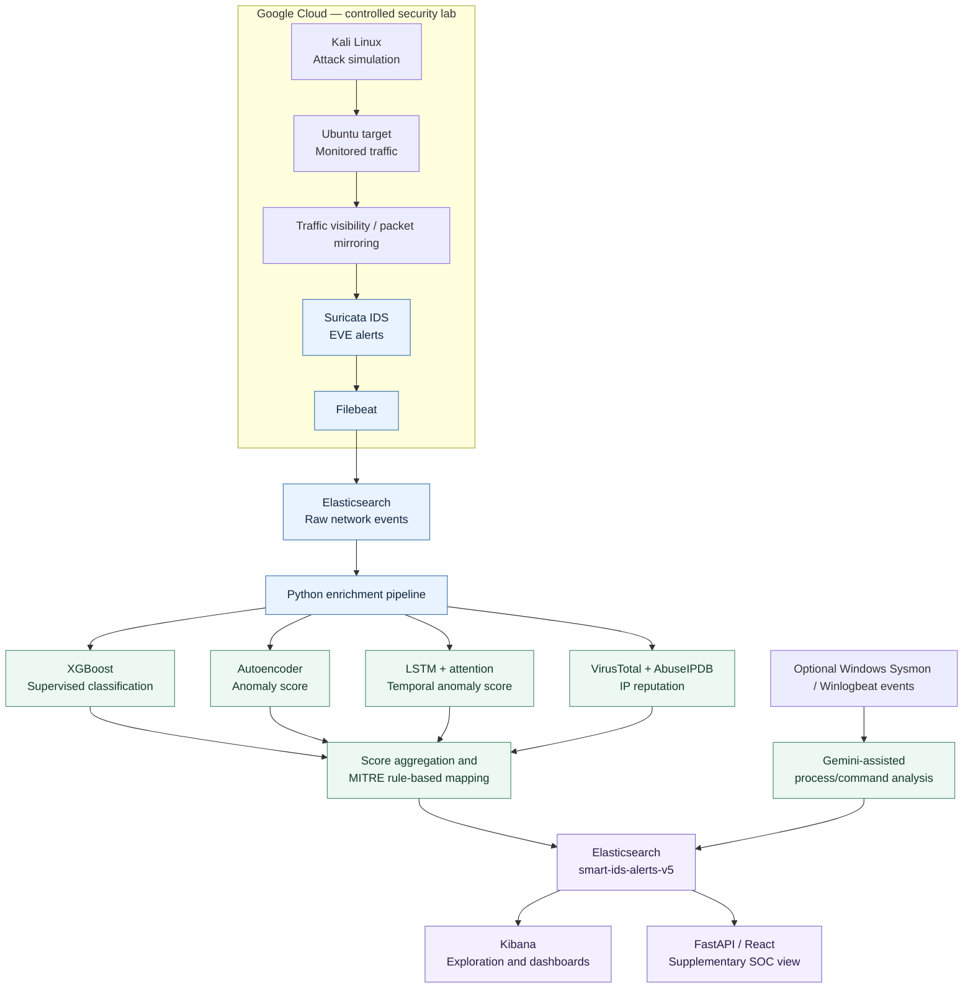

<div align="center">

# 🛡️ Smart-IDS Framework

### Hybrid Network Intrusion Detection with Suricata, Machine Learning & Threat Intelligence

**A cloud-based academic security engineering project exploring how signature-based detection, anomaly detection, temporal analysis, and contextual enrichment can work together in a SOC pipeline.**

[](https://www.python.org/)
[](https://suricata.io/)
[](https://xgboost.readthedocs.io/)
[](https://www.tensorflow.org/)
[](https://www.elastic.co/elastic-stack)
[](https://cloud.google.com/)
[](#project-scope-and-reproducibility)

[Overview](#overview) · [Architecture](#system-architecture) · [Detection Engine](#hybrid-detection-engine) · [Evaluation](#experimental-evaluation) · [Source Code](#repository-guide) · [Limitations](#project-scope-and-reproducibility)

</div>

---

## Overview

Conventional intrusion detection systems generate network alerts from signatures and protocol behavior. The harder problem is **turning those alerts into usable security context**: estimating their significance, detecting abnormal behavior, recognizing possible multi-step activity, and prioritizing what an analyst should inspect.

**Smart-IDS** investigates a layered approach to that problem. It combines **Suricata network telemetry**, an **XGBoost classifier**, an **autoencoder for anomaly scoring**, an **LSTM autoencoder with attention for temporal patterns**, and **IP reputation enrichment**. Alerts and associated scores are stored in Elasticsearch and explored through Kibana and a supplementary SOC dashboard.

### What this project explores

- **Signature-based detection:** process Suricata alerts for scans, brute-force attempts, denial-of-service patterns, and suspicious application traffic.
- **Supervised classification:** use engineered flow/alert features to estimate whether a network event resembles the attack class in the training data.
- **Unsupervised anomaly scoring:** identify observations whose feature patterns differ from learned normal behavior.
- **Temporal analysis:** examine short sequences of security events for anomalous progressions using an attention-based LSTM autoencoder.
- **Contextual enrichment:** combine ML outputs with VirusTotal and AbuseIPDB reputation signals and heuristic MITRE ATT&CK tagging.
- **SOC visibility:** index enriched alerts for investigation and optionally generate LLM-assisted analysis and reporting.

> **Project scope:** This is a **research/engineering prototype implemented in a GCP lab**, not a fully validated production IDS. Model performance figures below are taken from versioned experiment configurations; they have not been independently reproduced from the public repository.

## System architecture

The original laboratory setup used four Google Cloud virtual machines for simulated attacks, monitored traffic, IDS collection, and SOC processing. The documented design includes GCP packet mirroring toward a Suricata sensor.



**Primary data flow:** `Network traffic → Suricata → Filebeat → Elasticsearch → ML / CTI enrichment → prioritized alert index → analyst views`.

The current enrichment implementation polls the `filebeat-*` and `winlogbeat-*` indexes and writes processed records to `smart-ids-alerts-v5`. The network and endpoint paths are distinct: network events are scored by the ML pipeline; optional Windows process events are analyzed using a Gemini API integration.

## Hybrid detection engine

### 1. Suricata — signature detection and feature extraction

Suricata is the initial network sensor. It provides alert signatures, severity, flow metadata, and source/destination information. The processing scripts derive features such as:

| Feature group | Examples | Why it matters |
|---|---|---|
| Endpoint and protocol context | Source/destination ports, administrative ports | Characterize the observed service |
| Traffic volume | Bytes and packets in both directions | Distinguish communication patterns |
| Flow asymmetry | Byte/packet ratios, average packet size | Highlight unusual traffic balance |
| Event context | Rule severity, signature category, event hour | Add contextual signals to classification |

The original lab documentation reports **48,102 Emerging Threats Open signatures and 11 project-specific Suricata rules**. Their rule files are **not included in this public repository**, so this count is a documented lab configuration, not something that can currently be verified by cloning the project.

### 2. XGBoost — supervised attack classification

The XGBoost experiments use engineered network features to distinguish traffic labeled `ATTACK` from traffic labeled `NORMAL`. The public repository includes different training scripts and configuration generations:

- [`scripts/train_real_gcp_v4.py`](scripts/train_real_gcp_v4.py): trains an XGBoost model on the GCP-derived dataset, including feature engineering and class rebalancing.
- [`scripts/train_hybrid_final.py`](scripts/train_hybrid_final.py): experiments with combined datasets and a different feature set.
- [`models/xgb_v4_clean_config.json`](models/xgb_v4_clean_config.json): records a V4 experiment, its 21 features, the selected threshold, and reported evaluation metrics.

**Version note:** the published [`scripts/enrichment.py`](scripts/enrichment.py) still loads an **XGBoost V3** model, while the README and V4 configuration describe a later experimental result. The V4 score should therefore **not** be interpreted as the independently verified performance of the complete deployed V5 pipeline.

### 3. Autoencoder — anomaly detection

A feed-forward autoencoder learns to reconstruct feature patterns. Larger reconstruction errors can indicate atypical activity, including patterns that a signature-based detector or a supervised classifier may not describe well.

The repository contains the [autoencoder experiment configuration](models/autoencoder_config.json), including architecture, threshold, and recorded evaluation values. The binary model and training dataset are not distributed, and the published inference code should be checked for feature-dimension compatibility before its scores are relied upon.

### 4. LSTM + attention — temporal anomaly analysis

Individual network events may be benign or ambiguous when inspected in isolation. The LSTM experiment studies **ordered windows of alerts** rather than single records:

1. Extract alerts and relevant MITRE, risk, ML, and reputation fields.
2. Construct sequences of **10 events**, with each event represented by **6 features**.
3. Train an LSTM autoencoder with an attention mechanism on sequences labeled normal by the project heuristic.
4. Compare observed sequences with their reconstructions to derive a temporal anomaly score.
5. Evaluate the score using threshold-based classification.

Relevant files: [`extract_lstm_sequences.py`](scripts/extract_lstm_sequences.py), [`train_lstm_v4_pro.py`](scripts/train_lstm_v4_pro.py), and [`lstm_v4_config.json`](models/lstm_v4_config.json).

**Interpretation:** the project uses rule-derived labels for possible multi-stage behavior, based on technique diversity within time windows. These labels are useful for an exploratory experiment, but they are **not independently verified evidence of a real attacker kill chain**. The public streaming implementation also needs to align its feature inputs and per-source sequence grouping with the training process.

### 5. Threat intelligence and final prioritization

The enrichment pipeline requests external IP reputation information through **VirusTotal** and **AbuseIPDB**, with an in-memory cache for repeated lookups. It then combines reputation indicators with the ML outputs using a rule-based scoring function to assign **LOW, MEDIUM, HIGH, or CRITICAL** severity.

MITRE ATT&CK techniques are assigned through signature-keyword heuristics. They provide **investigative hints**, not a verified behavioral attribution.

**Important distinction:** the scoring formula is a custom engineering heuristic; it is not itself a learned, statistically calibrated probability of compromise.

## Experimental evaluation

The following numbers are **reported by the versioned JSON configuration files committed to the repository**. They are included for transparency, not as independently reproduced benchmark results.

| Experiment | Reported result | Evidence in repository |
|---|---|---|
| **XGBoost V4 Clean** | **AUC-ROC 0.9898** · Recall **93.47%** · FPR **4.63%** | [`xgb_v4_clean_config.json`](models/xgb_v4_clean_config.json) |
| **Feed-forward autoencoder** | **AUC-ROC 0.9612** · Recorded accuracy **99.16%** | [`autoencoder_config.json`](models/autoencoder_config.json) |
| **LSTM V4 + attention** | **AUC-ROC 0.9820** · Recall **89.47%** · FPR **1.09%** · F1 **0.85** | [`lstm_v4_config.json`](models/lstm_v4_config.json) |

**Dataset context.** The XGBoost V4 configuration records **7,733 attack-labeled** and **20,187 normal-labeled** examples. The dataset-generation code assigns labels using known attacker IPs in selected lab windows. These are **lab-derived labels**, not a publicly released, independently annotated benchmark.

**Evaluation caveats.** Some training scripts select early-stopping points or decision thresholds using a set also used for reporting scores. Additionally, model binaries and datasets are absent from the public repository. These limitations mean the results should not be read as deployment-level accuracy, generalization to unseen networks, or production false-positive rates.

## Detection scenarios and analyst workflow

The laboratory project targeted traffic patterns including:

| Security behavior | First-line signal | Additional analysis |
|---|---|---|
| Port scanning / reconnaissance | Suricata signatures and destination-port patterns | Flow features, MITRE heuristic `T1046` |
| SSH brute-force activity | Detection rules and repeated authentication-related activity | XGBoost-based scoring, MITRE heuristic `T1110` |
| SYN-flood / denial-of-service patterns | Suricata alerts and traffic volume | Asymmetry and anomaly scores, MITRE heuristic `T1499` |
| Suspicious web traffic / SQL injection | Suricata application signatures | ML/reputation enrichment, MITRE heuristic `T1190` |
| Possible multi-stage sequences | Temporal succession of alerts | LSTM reconstruction score; analyst verification required |

These are **project scenarios and detection categories**, not a claim that every attack class has been independently tested with published packet captures.

### From detection to an enriched alert

The intended investigation record brings together the network signature, model outputs, reputation signals, MITRE hint, and assigned severity. The pipeline writes fields including:

```text
@timestamp
src_ip / dst_ip
signature
xgb_confidence
ae_score
lstm_killchain
vt_score / abuse_score
mitre_technique
threat_level
model_version
```

These field names come from the source code; they are **not a fabricated example of measured output**. The resulting index supports filtered investigation in Kibana or the supplementary web interface.

## GCP laboratory environment

| Lab component | Role |
|---|---|
| **Attacker VM — Kali Linux** | Generate controlled network security scenarios |
| **Target VM — Ubuntu** | Produce monitored network activity |
| **IDS sensor** | Run Suricata and forward events through Filebeat |
| **SOC / analytics VM** | Host Elasticsearch, Kibana, Python enrichment, model inference, and the dashboard components |

The project documentation describes packet mirroring, Elastic Stack ingestion, and a Python polling-based enrichment service. Complete provisioning templates and cloud configuration files are not included in the repository.

### Optional LLM assistance

In addition to the network-centric ML pipeline, the project includes Gemini integrations for:

- Contextual analysis of **Sysmon process-creation events** and command lines.
- Analyst-requested explanations of alerts.
- SOC-oriented summary reporting.

These are supporting investigation capabilities. **Gemini is not the network intrusion detection model**: Suricata and the ML pipeline perform the primary network analysis. Gemini uses an external API, unlike a locally hosted inference model.

## Repository guide

The repository is organized primarily around **data extraction, model experimentation, and alert enrichment**:

```text
smart-ids/
├── README.md
├── requirements.txt
├── .env.example
├── scripts/
│   ├── enrichment.py                # Suricata/ML/CTI enrichment pipeline
│   ├── export_dataset.py            # Extract Suricata alerts from Elasticsearch
│   ├── export_real_dataset_v2.py    # GCP lab dataset extraction and labeling
│   ├── label_dataset.py             # Label recorded traffic using lab time windows
│   ├── extract_lstm_sequences.py    # Construct temporal event windows
│   ├── train_real_gcp_v4.py         # XGBoost training experiment
│   ├── train_hybrid_final.py        # Hybrid-dataset XGBoost experiment
│   └── train_lstm_v4_pro.py         # LSTM autoencoder with attention
├── models/
│   ├── xgb_v4_clean_config.json     # Recorded XGBoost evaluation/config
│   ├── autoencoder_config.json      # Recorded autoencoder configuration
│   ├── lstm_v4_config.json          # Recorded LSTM evaluation/config
│   └── .model_manifest.json         # Model integrity metadata, not model binaries
├── dashboard/
│   ├── backend.py                   # FastAPI alert and analysis endpoints
│   └── frontend/                   # React SOC interface
├── auth_module.py
├── input_validation.py
├── llm_security.py
└── model_security.py
```

**Suggested review path for recruiters:** start with [`scripts/enrichment.py`](scripts/enrichment.py), then inspect [`train_real_gcp_v4.py`](scripts/train_real_gcp_v4.py), [`train_lstm_v4_pro.py`](scripts/train_lstm_v4_pro.py), and the [`models/`](models/) experiment metadata.

## Project scope and reproducibility

**Available publicly:** the main enrichment logic, Python model-training and data-processing scripts, experiment configuration JSON files, API/frontend source, and archived engineering notes.

**Not available publicly:** training datasets, `.pkl`/`.keras` model weights, a fully reproducible GCP/Suricata deployment, the custom Suricata rule files, and comprehensive automated tests. The code also contains original environment-specific paths and references to a private `secure_secrets.py` helper, so a clean clone is **not a turnkey installation**.

The repository should therefore be approached as an **implementation and experiment record**, not a one-command demonstration or deployable security product.

### Current technical limitations and next steps

1. **Align experimentation and inference:** use consistent model versions, feature schemas, preprocessing and thresholds throughout the pipeline.
2. **Strengthen temporal detection:** maintain LSTM windows per source/context and validate multi-stage labels against independently confirmed scenarios.
3. **Improve evaluation:** separate train/validation/test data, report confusion matrices and performance on unseen lab sessions, and document threshold selection.
4. **Make processing robust:** paginate event reads, identify/reconcile duplicate events, and expose failures rather than silently discarding model errors.
5. **Enable reproduction:** publish sanitized synthetic examples, selected rule definitions and a reproducible environment specification when available.

## Author

**Achref Mansouri** — ICT Engineering Student, [SUP'COM — Higher School of Communications of Tunis](https://www.supcom.tn/)

[GitHub](https://github.com/Achref88MANSOURI) · [LinkedIn](https://www.linkedin.com/in/achref-mansouri-84a012244/)

---

<sub>Academic security engineering project. All stated scores are reported experiment artifacts unless otherwise indicated. No claim of independently validated production detection performance is made.</sub>